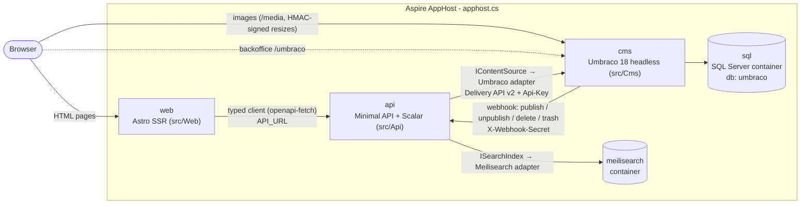

# Aspire headless CMS demo

An [Aspire](https://aspire.dev) solution with a headless **Umbraco 18** CMS, a typed **.NET 10 API** with
swappable content and search adapters, **Meilisearch** for search, and an **Astro 7 + Tailwind 4** SSR website.
Local development runs entirely from the Aspire AppHost (`apphost.cs`); Azure deployment uses Terraform
(`infra/terraform`, see [docs/deployment.md](docs/deployment.md)).

## Architecture



- **cms** – Umbraco with the Delivery API enabled and protected by an API key (`PublicAccess=false`). There is no
  website rendering: no `AddWebsite()`/`UseWebsite()`, no Views, and templates are blocked in code
  (`src/Cms/Headless/HeadlessComposer.cs`). ImageSharp resize requests must carry a valid `hmac` (HMAC secret
  configured), so unsigned `?width=...` requests get a 400. On first start it installs unattended into SQL Server,
  imports the schema (document, element and data types) from **uSync** (`src/Cms/uSync/v18`), seeds demo content
  (`ContentSeeder.cs`, `DemoArticles.cs`) and registers a webhook pointing at the API
  (`ContentWebhookRegistrar.cs`). See [Content model](#content-model).
- **api** – the only thing the website talks to. It exposes a CMS- and search-engine-neutral contract
  (`src/Api/Contracts`) and builds absolute media URLs and HMAC-signed `srcset` renditions (480/960/1440/1920).
  On startup it ensures the search index and runs a full reindex in the background (retrying until the CMS has
  content). Content webhooks keep the index up to date afterwards.
- **web** – Astro server-side rendering only; the browser never calls the API directly. The API client is
  generated from the API's OpenAPI document.

## Prerequisites

- .NET SDK 10.0.300+
- Aspire CLI 13.6+ (`aspire --version`)
- Node.js 24+ and npm
- A container runtime: Docker, or **Podman** (see below)
- Optional, for deployment: Terraform 1.9+ (or OpenTofu) and the Azure CLI

## Run locally

```sh
aspire run                  # interactive; Ctrl+C to stop
# or detached:
aspire start && aspire describe
aspire stop
```

With Podman, tell Aspire which runtime to use (it is not baked into the repo because it is machine-specific):

```sh
export ASPIRE_CONTAINER_RUNTIME=podman        # bash/zsh
set -gx ASPIRE_CONTAINER_RUNTIME podman       # fish
```

What happens on start:

1. `sql`, `meilisearch` and `seq` start as **persistent** containers with data volumes (they survive `aspire stop`).
2. `cms` waits for the database, installs Umbraco unattended (first run only), imports the uSync schema
   ("uSync First boot complete 12 changes" in the log), seeds the demo content and registers the webhook. A fresh
   install takes about a minute; Umbraco's Delivery API query index fills about a minute after that.
3. `api` waits for Meilisearch, then reindexes in the background once the CMS returns content.
4. `web` runs `npm install` + `npm run dev` (Astro dev server on Aspire's `PORT`) once the api is healthy.

Secrets (`umbraco-admin-password`, `delivery-api-key`, `hmac-secret`, `webhook-secret`, `reindex-secret`, plus Aspire's own
`sql-password` and `meilisearch-masterKey`) are generated on first run and stored in the AppHost user secrets:

```sh
dotnet user-secrets list --project apphost.cs
```

Keep them stable: the persistent SQL volume was initialised with `sql-password`. If you reset the user secrets,
also remove the `sql` container and its volume.

### Start from a clean database

uSync's first-boot import and the seeder only run against an empty database (the seeder skips when a root `site`
node exists). To reinstall from scratch, for example after pulling a schema change that conflicts with your local
data, stop the AppHost and remove this AppHost's `sql`/`meilisearch` containers and volumes plus local media and
Examine indexes (the hash in the names is per AppHost path; check with `podman ps -a` / `podman volume ls`):

```sh
aspire stop
podman rm -f sql-<hash> meilisearch-<hash>
podman volume rm apphost-<hash>-sql-data apphost-<hash>-meilisearch-data
rm -rf src/Cms/wwwroot/media src/Cms/umbraco/Data/TEMP
aspire start
```

## URLs

| What | URL |
| --- | --- |
| Aspire dashboard | `https://localhost:17039` (the login link with token is printed by `aspire run` / `aspire start`) |
| Seq (log search) | `http://localhost:5341` (no login locally) |
| Website | shown on the `web` resource in the dashboard (random port) |
| Umbraco backoffice | `https://localhost:44350/umbraco` (or `http://localhost:28048/umbraco`) |
| Backoffice login | user `admin@example.com` (parameter `umbraco-admin-email`), password = `Parameters:umbraco-admin-password` from the user secrets |
| API reference (Scalar) | `http://localhost:5194/scalar` |
| OpenAPI document | `http://localhost:5194/openapi/v1.json` |
| Delivery API (needs `Api-Key` header) | `http://localhost:28048/umbraco/delivery/api/v2/content/item/articles` |

Scalar and the OpenAPI document are mapped in every environment on purpose for this demo (`src/Api/Program.cs`).

### API endpoints

| Method | Path | Notes |
| --- | --- | --- |
| GET | `/api/content?path=/articles&culture=` | `Page` or 404 ProblemDetails |
| GET | `/api/content/{id}` | `Page` or 404 |
| GET | `/api/navigation` | `NavItem[]` tree of site and pages (articles are excluded) |
| GET | `/api/articles?tag=&page=1&pageSize=12&culture=` | `Paged<ArticleSummary>`, newest `publishDate` first |
| GET | `/api/tags` | `TagCount[]` (`{tag, count}`), most used first |
| GET | `/api/search?q=&page=1&pageSize=10&contentType=&tag=` | `SearchResult`, highlights wrapped in `<mark>`; hits carry tags, date, thumbnail |
| POST | `/api/search/reindex` | full reindex; header `X-Reindex-Secret` (parameter `reindex-secret`) |
| POST | `/api/webhooks/content` | Umbraco webhook (`{"id": ...}` or `[{"id": ...}]`); header `X-Webhook-Secret` |

Trigger a reindex by hand:

```sh
curl -X POST -H "X-Reindex-Secret: <reindex-secret>" http://localhost:5194/api/search/reindex
```

The webhook secret is deliberately not accepted there: it is stored on the Umbraco webhook, where backoffice users
with Settings access can read it.

Website routes: `/` and `/articles` (block pages), `/articles/<slug>` (article), `/tags/<tag>` (paged listing),
`/search?q=&tag=`.

## Observability (local)

- **Aspire dashboard** – traces, metrics, structured logs and console output of every resource.
- **Seq** (`http://localhost:5341`) – searchable log and trace store that survives restarts (persistent container
  + data volume). `WithReference(seq)` gives cms, api and web a `ConnectionStrings__seq`; `AddServiceDefaults()`
  then ships OpenTelemetry logs and traces to Seq *in addition to* the dashboard (`AddSeqEndpoint`, Aspire.Seq).
  Seq's health check is disabled there so a stopped Seq never marks an app unhealthy. Umbraco logs through
  Serilog, which bypasses that pipeline, so `src/Cms/Program.cs` adds two Serilog OpenTelemetry sinks (dashboard
  and Seq). The Node web app is not instrumented: it shows up only through the api requests it makes, and its
  console output stays in the dashboard.
  Filter by app in Seq with `@Resource.service.name = 'cms'` (or `api`); for example `@Message like '%uSync%'`
  shows the first-boot import and `@MessageTemplate like 'Reindex%'` the api's index sync.
- `/health` (all checks, status text only) and `/alive` (liveness) are mapped in every environment.
- Seq signals and alerts (error spike, webhook secret rejections, reindex/Meilisearch failures, Delivery API
  failures) are created by `infra/seq/alerts.sh`; try them locally (authentication is off, so any key works):

  ```sh
  SEQ_URL=http://localhost:5341 SEQ_API_KEY=local infra/seq/alerts.sh   # needs podman or docker, curl, jq
  ```

Seq is free for a single user; see [docs/deployment.md](docs/deployment.md#seq) for licensing and the Azure setup.

## Content model

The schema lives in **uSync** files (`src/Cms/uSync/v18`, uSync 18.2.0) and is the source of truth: on a fresh
database uSync imports it on first boot (`uSync:Settings:ImportOnFirstBoot`), before the seeder runs.

| Type | Kind | Properties | Allowed under |
| --- | --- | --- | --- |
| `site` | document | `blocks` (Content Blocks) | root |
| `page` | document | `title`, `blocks` (Content Blocks) | `site`, `page` |
| `article` | document | `title`, `image` (single image), `body` (Markdown), `tags` (group `articles`), `publishDate` (optional; falls back to the create date) | `page` |
| `heroBlock` | element | `heading`, `subheading`, `image`, `ctaLabel`, `ctaLink` (one link) | Content Blocks |
| `ctaBlock` | element | `heading`, `text`, `link` (one link), `style` (`primary`/`secondary`) | Content Blocks |
| `latestArticlesBlock` | element | `heading`, `count` (1–50, empty = 6), `tag` (optional, a single tag; a list or `!tag` is ignored) | Content Blocks |

Seeded demo content (`ContentSeeder.cs`, idempotent, deterministic seed, one transaction so a failed seed leaves
nothing behind and is retried on the next boot): **Home** (`site`, blocks hero, latest articles ×6, CTA) → **Articles** (`page`, `/articles`, blocks hero, latest articles ×12) → 50 articles with
Markdown bodies, 2–4 of 12 tags each, publish dates over the last 12 months, and 12 generated 1600×900 JPEG
placeholder images in the media library. Content is created in C#, not via uSync content import, so the repo
only holds schema and no media files.

`src/Cms/Headless/ArticleQueryHandlers.cs` adds two Delivery API query extensions the API relies on:
`sort=publishDate:asc|desc` and `filter=tag:<a,b>` (any of the tags, `!` to exclude, case-insensitive).

How the API exposes it (`src/Api/Contracts`):

- `Page.blocks` is a polymorphic `Block[]` with discriminator `type` (`hero` | `cta` | `latestArticles`; OpenAPI
  `oneOf` + discriminator, a TypeScript discriminated union in the web). `latestArticles` blocks arrive resolved
  (`articles: ArticleSummary[]`). Links are `{url, title?, target?}`; content links become site paths
  (`/articles`).
- `Page.article` is non-null exactly when `contentType == "article"`: `{publishDate, tags, bodyHtml,
  readingTimeMinutes}`. The Markdown is rendered by Markdig with raw HTML disabled and only http(s)/mailto/tel/
  relative URLs allowed, so `bodyHtml` can be inserted as-is. `Page.summary` is a ~160-character plain-text excerpt.

### Changing the schema (uSync workflow)

1. Edit document types, element types or data types in the backoffice (Settings). uSync exports every saved
   change to `src/Cms/uSync/v18` (`ExportOnSave: "Settings"`; content and media are never exported, and the
   webhook handler is disabled so its secret never lands in the repo).
2. Review and commit the changed `.config` files together with the API/web code that uses them (update
   `DeliveryApiMapper` and the fixtures in `tests/Api.Tests/Fixtures/delivery` if the JSON shape changes).
3. Other machines and new environments get the schema on a fresh database automatically. For an existing
   database, import it in the backoffice: Settings > uSync > Import (or reset the local database, see
   [Start from a clean database](#start-from-a-clean-database)).

## Adapters: how the API stays CMS/search-engine neutral

The endpoints only depend on two ports and the contract records:

- `src/Api/Content/IContentSource.cs` – `GetByPathAsync`, `GetByIdAsync`, `GetNavigationAsync`,
  `GetArticlesAsync`, `GetTagsAsync`, plus the enumeration used for indexing.
- `src/Api/Search/ISearchIndex.cs` – `SearchAsync`, `ReplaceAllAsync`, `CountAsync`, upsert/delete and path lookups.

Implementations live in adapter folders and never leak their types into `Contracts/` or `Endpoints/`:

- `src/Api/Content/Umbraco/` – typed `HttpClient` against the Umbraco Delivery API v2 (`DeliveryApiMapper` maps the
  JSON to `Page`, `ImageUrlSigner` signs renditions with ImageSharp.Web's `HMACUtilities`).
- `src/Api/Search/Meilisearch/` – Meilisearch client (`AddMeilisearchClient("meilisearch")`), index `content`.

The adapter is chosen at startup from configuration (`Providers:Content`, `Providers:Search`); an unknown value
throws at startup. The AppHost sets `Providers__Content=Umbraco` and `Providers__Search=Meilisearch`.

### Adding a provider

Example: a Contentful content source.

1. Create `src/Api/Content/Contentful/` with a `ContentfulContentSource : IContentSource`, its options and an
   `AddContentfulContentSource(this IHostApplicationBuilder)` extension that registers it (typed `HttpClient`,
   options validation, ...). Map the provider's JSON to the contract records there.
2. Add one switch arm in `src/Api/Content/ContentServiceCollectionExtensions.cs`:

   ```csharp
   case "Contentful":
       builder.AddContentfulContentSource();
       break;
   ```
3. Set `Providers__Content=Contentful` (AppHost `WithEnvironment`, or Terraform for Azure) plus the provider's own
   settings. Feed index updates by calling `POST /api/webhooks/content` with `{"id": "..."}` from the new CMS, or
   rely on `POST /api/search/reindex`.

A new search engine works the same way: `src/Api/Search/<Engine>/` implementing `ISearchIndex`, plus one arm in
`src/Api/Search/SearchServiceCollectionExtensions.cs` and `Providers__Search=<Engine>`.

## Regenerating the web API types

`dotnet build src/Api` regenerates `src/Api/openapi/Api.json` (Microsoft.Extensions.ApiDescription.Server). The
website's types are generated from that file and committed:

```sh
dotnet build src/Api
cd src/Web
npm run gen:api      # openapi-typescript ../Api/openapi/Api.json -> src/lib/api/schema.d.ts
npm run build        # astro check + astro build
```

## Tests

```sh
dotnet build AspireTest.slnx
dotnet test tests/Api.Tests     # HMAC signing vs real ImageSharp.Web middleware, Delivery API mapping (fixtures
                                # captured from the running CMS), Markdown safety, polymorphic JSON, provider selection
```

## Deployment

Azure (Container Apps, Azure SQL, Blob Storage for media, Azure Files for Meilisearch, Key Vault, ACR) is described
in Terraform under `infra/terraform`. See **[docs/deployment.md](docs/deployment.md)** for the architecture, building
and pushing images, `terraform apply`, the first run and secret rotation.
