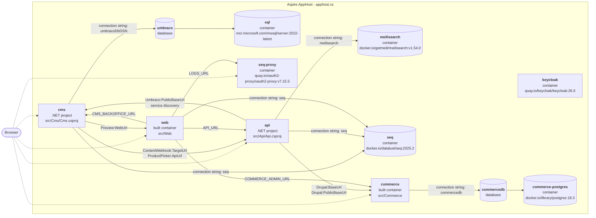

# Aspire headless CMS demo

An [Aspire](https://aspire.dev) solution with a headless **Umbraco 18** CMS, a headless **Drupal 11 + Commerce 3**
shop backend, a typed **.NET 10 API** with swappable content, commerce and search adapters, **Meilisearch** for search,
and an **Astro 7 + Tailwind 4 + Starwind UI** SSR website.
Local development runs entirely from the Aspire AppHost (`apphost.cs`); Azure deployment uses Terraform
(`infra/terraform`, see [docs/deployment.md](docs/deployment.md)).
Guidance for coding agents (commands, generated files, how a change flows through the stack) is in
[AGENTS.md](AGENTS.md).

## Architecture

<!-- architecture:start -->
<!-- Generated by scripts/gen-architecture.mjs from the Aspire manifest; do not edit by hand. -->



<!-- architecture:end -->

The diagram is generated from the AppHost model (resources and the references between them, via the Aspire
manifest): `node scripts/gen-architecture.mjs` rewrites it, and CI commits the update on `main` after any change to
`apphost.cs`. Dotted arrows are external endpoints.

- **cms** – Umbraco with the Delivery API enabled and protected by an API key (`PublicAccess=false`). There is no
  website rendering: no `AddWebsite()`/`UseWebsite()`, no Views, and templates are blocked in code
  (`src/Cms/Headless/HeadlessComposer.cs`). ImageSharp resize requests must carry a valid `hmac` (HMAC secret
  configured), so unsigned `?width=...` requests get a 400. On first start it installs unattended into SQL Server,
  imports the schema (document, element and data types) from **uSync** (`src/Cms/uSync/v18`), seeds demo content
  when `DemoContent:Enabled` is on (`ContentSeeder.cs`, `DemoArticles.cs`, `DemoBlogPosts.cs`) and registers a
  webhook pointing at the API (`ContentWebhookRegistrar.cs`). See [Content model](#content-model).
- **api** – the only thing the website talks to. It exposes a CMS- and search-engine-neutral contract
  (`src/Api/Contracts`) and builds absolute media URLs and HMAC-signed `srcset` renditions (480/960/1440/1920).
  On startup it ensures the search index and runs a full reindex in the background (retrying until the CMS has
  content). Content webhooks keep the index up to date afterwards, and a full reindex every `Search:ReindexInterval`
  (default 30 minutes, `00:00:00` disables it) catches anything a lost webhook missed. After each content webhook
  it purges the web cache.
- **web** – Astro server-side rendering only; the browser never calls the API directly. The API client is
  generated from the API's OpenAPI document.
- **commerce** – Drupal 11 + Commerce 3 (`src/Commerce`, PostgreSQL in `commerce-postgres`): catalog, carts, orders
  and a fake card payment, used only through the JSON endpoints of its `headless_commerce` module. See
  [Commerce](#commerce-drupal).

## New project from this template

The repository is a `dotnet new` template (`.template.config/template.json`). Install it from a clean clone, so
ignored local files (build output, `node_modules`, media) are not part of it:

```sh
git clone <this repo> aspire-headless-template
dotnet new install ./aspire-headless-template
dotnet new aspire-headless -n ContosoShop            # empty CMS and catalog
dotnet new aspire-headless -n ContosoShop --demo     # with demo articles, blog posts and 2000 products
```

The name is applied in three forms: `ContosoShop` (solution file), `contoso-shop` (`UserSecretsId`, so every project
has its own secret store, image repository prefix, tfstate key and tags) and `contososhop` (Azure resource names).
The fixed host ports (Keycloak, cms, commerce, web, Seq, Aspire dashboard) are replaced by random free ports,
so several generated projects can run on one machine; the Keycloak realm redirect URIs and these docs use the same
values. After creating a project: `git init`, `scripts/init-secrets.sh`, `aspire start`, then create a `site` node
in the backoffice unless `--demo` was used.

## Prerequisites

- .NET SDK 10.0.300+
- Aspire CLI 13.6+ (`aspire --version`)
- Node.js 24+ and npm
- A container runtime: Docker, or **Podman** (see below)
- Optional, for deployment: Terraform 1.9+ (or OpenTofu) and the Azure CLI

## Run locally

```sh
aspire run                  # interactive; Ctrl+C to stop
# or detached:
aspire start && aspire describe
aspire stop
```

With Podman, tell Aspire which runtime to use (it is not baked into the repo because it is machine-specific):

```sh
export ASPIRE_CONTAINER_RUNTIME=podman        # bash/zsh
set -gx ASPIRE_CONTAINER_RUNTIME podman       # fish
```

What happens on start:

1. `sql`, `meilisearch` and `seq` start as **persistent** containers with data volumes (they survive `aspire stop`).
2. `cms` waits for the database, installs Umbraco unattended (first run only), imports the uSync schema
   ("uSync First boot complete" in the log; later schema changes need a backoffice import, see
   [Changing the schema](#changing-the-schema-usync-workflow)), seeds the demo content (`DemoContent:Enabled`) and
   registers the webhook. A fresh install takes about a minute; Umbraco's Delivery API query index fills about a
   minute after that.
3. `commerce-postgres` starts (persistent) and `commerce` builds its image, installs Drupal into the empty database
   on first start, installs the `headless_commerce` module and seeds 2000 demo products (about two minutes the first
   time; later starts only check). Its admin UI (Gin admin theme) is at
   `<commerce url>/user/login`.
4. `api` waits for Meilisearch, then reindexes content and products in the background once the CMS and Drupal answer.
5. `web` runs `npm install` + `npm run dev` (Astro dev server on Aspire's `PORT`, reached at
   `http://localhost:8082`) once the api is healthy.

### Local secrets

All secrets are Aspire parameters stored in the AppHost **user secrets** (`Parameters:<name>`), never in
`appsettings*.json` or `.env` files (`appsettings.Local.json` and `.env*` are git-ignored). `apphost.cs` sets a fixed
`UserSecretsId` (`aspire-test-apphost`), so the store is `~/.microsoft/usersecrets/aspire-test-apphost/secrets.json`
(`aspire secret path`) no matter where the repository is checked out.

Create them once before the first `aspire run` (the AppHost would also generate missing ones on start):

```sh
scripts/init-secrets.sh                        # sets only missing keys, prints the backoffice login
scripts/init-secrets.sh --rotate reindex-secret
aspire secret list                             # or: aspire secret get Parameters:umbraco-admin-password
```

| Parameter | Value |
| --- | --- |
| `umbraco-admin-email` | `admin@example.com` |
| `umbraco-admin-password`, `delivery-api-key`, `webhook-secret`, `reindex-secret` | 32 random alphanumeric characters |
| `hmac-secret` | base64 of 64 random bytes |
| `commerce-admin-password` | 32 random alphanumeric characters (Drupal user `admin`) |
| `commerce-api-key`, `commerce-hash-salt` | 32 random alphanumeric characters (the API's key for Drupal; Drupal's hash salt) |
| `seq-proxy-cookie-secret` | 32 random alphanumeric characters (oauth2-proxy's cookie key for the Seq login) |
| `web-staff-oidc-secret` | 32 random alphanumeric characters (client secret of `web-staff`, the website's staff sign-in) |
| `web-session-secret` | 32 random alphanumeric characters (encrypts the web's customer session cookie; rotating it signs every customer out) |
| `preview-api-key` | 32 random alphanumeric characters (the web's key for draft content on the API, see [Preview](#preview)) |
| `sql-password`, `meilisearch-masterKey`, `commerce-postgres-password` | 32 random alphanumeric characters (Aspire's own parameters for `sql`, `meilisearch` and `commerce-postgres`) |

The script is idempotent and never changes an existing value: the persistent containers depend on them. It uses
`openssl rand`, `jq` and the Aspire CLI (`aspire secret`). Local Seq itself runs without authentication (its UI is
reachable only through the staff login, see [Observability](#observability-local)), so it has no password.

Rotating (`--rotate <name>`, then restart the AppHost):

- `delivery-api-key`, `hmac-secret`, `webhook-secret`, `reindex-secret`, `preview-api-key`: just restart; the cms
  reconciles the webhook's secret header on start and the api re-signs image URLs.
- `seq-proxy-cookie-secret`: just restart; Seq users sign in again.
- `umbraco-admin-email`/`-password`: only used by the unattended install, so change the user in the backoffice too.
- `sql-password`, `meilisearch-masterKey`: fixed when the persistent container and its volume are first created.
  The script asks for confirmation and prints the `podman rm`/`podman volume rm` commands; running them deletes the
  data (see [Start from a clean database](#start-from-a-clean-database)).

Before the fixed `UserSecretsId`, the SDK derived the ID from the AppHost path (`apphost-<sha256>`). The first run of
`scripts/init-secrets.sh` copies the keys of such an existing store that the new ID lacks, so run it after pulling this
change and before `aspire run`; otherwise the AppHost generates a new `sql-password` that no longer matches the
existing `sql` volume. The script then warns and prints the command that restores the old value.

### Start from a clean database

uSync's first-boot import only runs against an empty database, and the seeder only tops up its own demo content on an
existing one. To reinstall from scratch, for example after pulling a schema change that conflicts with your local
data, stop the AppHost and remove this AppHost's `sql`/`meilisearch`/`commerce-postgres` containers and volumes plus
local media, Drupal's files and Examine indexes (the hash in the names is per AppHost path; check with `podman ps -a` /
`podman volume ls`):

```sh
aspire stop
podman rm -f sql-<hash> meilisearch-<hash> commerce-postgres-<hash>
podman volume rm apphost-<hash>-sql-data apphost-<hash>-meilisearch-data apphost-<hash>-commerce-postgres-data commerce-files
rm -rf src/Cms/wwwroot/media src/Cms/umbraco/Data/TEMP
aspire start
```

## URLs

| What | URL |
| --- | --- |
| Aspire dashboard | `https://localhost:17039` (the login link with token is printed by `aspire run` / `aspire start`) |
| Seq (log search) | `http://localhost:5341` (staff login, role `admin`); `http://localhost:5342` is log ingestion only |
| Website | `http://localhost:8082` (the `web` resource) |
| Umbraco backoffice | `https://localhost:44350/umbraco` (or `http://localhost:28048/umbraco`) |
| Drupal admin | `http://localhost:8081/user/login`: "Log in with Staff sign-in" (Keycloak realm `staff`, user `admin`, password = `Parameters:idp-admin-password`). Break-glass: `drush uli` in the `commerce` container (user `admin`) |
| Backoffice login | user `admin@example.com` (parameter `umbraco-admin-email`), password = `Parameters:umbraco-admin-password` from the user secrets; or "Single sign-on" with Keycloak user `admin`, password = `Parameters:idp-admin-password` (see [Backoffice sign-in](#backoffice-sign-in-oidc)) |
| API reference (Scalar) | `http://localhost:5194/scalar` |
| OpenAPI document | `http://localhost:5194/openapi/v1.json` |
| Delivery API (needs `Api-Key` header) | `http://localhost:28048/umbraco/delivery/api/v2/content/item/articles` |

Scalar and the OpenAPI document are mapped in every environment on purpose for this demo (`src/Api/Program.cs`).

### API endpoints

| Method | Path | Notes |
| --- | --- | --- |
| GET | `/api/content?path=/articles&culture=` | `Page` or 404 ProblemDetails |
| GET | `/api/content/{id}` | `Page` or 404 |
| GET | `/api/preview/content/{id}?culture=` | draft `Page` for the staff [preview](#preview); header `X-Preview-Key` (parameter `preview-api-key`); 401 without it, 404 when no key is configured; `no-store` |
| GET | `/api/navigation` | `NavItem[]` tree of site and pages (articles and blog posts are excluded) |
| GET | `/api/articles?tag=&page=1&pageSize=12&culture=` | `Paged<ArticleSummary>`, newest `publishDate` first |
| GET | `/api/tags` | `TagCount[]` (`{tag, count}`), most used first |
| GET | `/api/sitemap` | `Sitemap`: every published page path and product slug with `updatedAt`; reads the whole site and catalog, for the web's `/sitemap.xml` only |
| GET | `/api/search?q=&page=1&pageSize=10&contentType=&tag=&year=` | `SearchResult`, highlights wrapped in `<mark>`; hits carry tags, date, image; `facets` counts types, tags and years (each ignoring its own filter); empty `q` lists everything newest first |
| POST | `/api/search/reindex` | full reindex; header `X-Reindex-Secret` (parameter `reindex-secret`) |
| POST | `/api/webhooks/content` | Umbraco webhook (`{"id": ...}` or `[{"id": ...}]`); header `X-Webhook-Secret` |
| GET | `/api/products?q=&category=&brand=&minRating=&inStock=&sort=&page=1&pageSize=24` | `ProductSearchResult` with facets (categories, brands, ratings, availability); `sort` = relevance, popular, price-asc, price-desc, rating, newest |
| GET | `/api/products/{slug}` | `Product`, live from Drupal; an outdated slug still finds it (compare `slug` and redirect) |
| POST | `/api/carts` | `CreatedCart` (`token` + `cart`); every other cart call needs `X-Cart-Token` |
| GET | `/api/carts/{cartId}` | `Cart`; 404 for unknown carts and wrong tokens alike |
| POST | `/api/carts/{cartId}/items` | `{sku, quantity}`; 409 `out_of_stock` with `available` |
| PATCH / DELETE | `/api/carts/{cartId}/items/{itemId}` | `{quantity}` (0 removes) / remove |
| POST | `/api/carts/{cartId}/checkout` | `CheckoutRequest` → `OrderReceipt`; 400 field errors, 402 declined card, 409 empty cart / stock / already checked out. With a customer's `Authorization: Bearer` token the order is theirs; 401 for an invalid or expired one |
| GET | `/api/me/orders?page=1&pageSize=10` | `OrderPage` of the customer's placed orders, newest first; needs the customer's bearer token (401 without, and always when `CustomerAuth` is off) |
| GET | `/api/status` | `StatusReport` (`status` + `components[]` of `{name, displayName, status, durationMs}`), always 200; see below |

`/api/status` runs the health checks tagged `dependency`. Each adapter registers its own inside its `AddXxx` method
(Umbraco: `content`, one Delivery API query with the key, `Degraded` on failure; Meilisearch: `search`, its
`/health`, `Unhealthy` on failure), so a new adapter does the same and the endpoint stays adapter-neutral. Each
check has a 2 s timeout and the report is cached for 10 s (concurrent callers share one evaluation), so the page
never hammers the dependencies and `checkedAt` can be up to 10 s old. The status is in the body and the response is
always 200; only names, statuses and durations are returned, never exception messages, URLs or keys.

Trigger a reindex by hand:

```sh
curl -X POST -H "X-Reindex-Secret: <reindex-secret>" http://localhost:5194/api/search/reindex
```

The webhook secret is deliberately not accepted there: it is stored on the Umbraco webhook, where backoffice users
with Settings access can read it.

Website routes: `/`, `/articles` and `/blog` (block pages), `/articles/<slug>` (article), `/blog/<slug>` (blog post,
with a card linking its related article), `/shop` (products with facets and sorting), `/shop/<slug>` (product with
stats and specs), `/cart` and `/checkout` (per visitor, `no-store`), `/account` (profile and orders of the signed-in
customer, `no-store`), `/auth/login?returnTo=`, `/auth/callback` and `/auth/logout` (customer sign-in, `no-store`), `/tags/<tag>` (paged listing),
`/search?q=&tag=`, `/status` (system status: Web, API round trip and each `/api/status` component; `no-store`, a
Refresh link instead of auto-reload, and still renders with "API Down / Dependencies Unknown" when the API fails or
takes longer than 3 s). `/status` is a web route, so a CMS page at that path is hidden behind it.

### Caching

Pages are rendered per request (Astro SSR) and carry no shared-cache headers, so a publish shows up on the next
request. Per-visitor pages and endpoints (`/cart`, `/checkout`, `/account`, `/status`, `/api/cart`, `/api/me`,
`/api/staff`, `/auth/*`, `/preview/*`) send `no-store`; `/api/suggest` sends `max-age=60`; `/sitemap.xml` and
`/robots.txt` send `public, max-age=3600`.

### SEO

Every page gets a canonical link (path plus `page` when above 1, so filtered, sorted and searched listings collapse
onto the listing), Open Graph and Twitter card tags (`Layout.astro`). Search results, per-visitor and error pages
are `noindex` instead. `/robots.txt` keeps crawlers out of the per-visitor paths and points at `/sitemap.xml`, which
lists every published page and product from `/api/sitemap`. Absolute URLs use `SITE_URL`.

## Observability (local)

- **Aspire dashboard** – traces, metrics, structured logs and console output of every resource.
- **Seq** – searchable log and trace store that survives restarts (persistent container + data volume). The UI is
  `http://localhost:5341`: `seq-proxy` (oauth2-proxy, generic OIDC) signs you in through the IdP's staff realm and
  lets only the `admin` value of the `roles` claim through; it refreshes the session every 5 minutes (a removed role
  or ended IdP session locks you out), sessions last 8 hours and signing out ends the IdP session too. Seq itself
  runs without authentication, but its UI and API (container port 80) are not published to the host: only Seq's
  ingestion-only port is (`http://localhost:5342`, no UI or API), which is where the apps ship their logs (ingestion
  never goes through the login). `WithReference(seq)` gives cms, api and web a `ConnectionStrings__seq`; `AddServiceDefaults()` then ships OpenTelemetry logs and traces to Seq *in addition to* the dashboard (`AddSeqEndpoint`, Aspire.Seq).
  Seq's health check is disabled there so a stopped Seq never marks an app unhealthy. Umbraco logs through
  Serilog, which bypasses that pipeline, so `src/Cms/Program.cs` adds two Serilog OpenTelemetry sinks (dashboard
  and Seq). The Node web app preloads `src/Web/otel.mjs` (`node --import`, in
  `npm run dev`/`start` and the Dockerfile): http server and fetch (undici) spans plus log records go to the
  dashboard when `OTEL_EXPORTER_OTLP_ENDPOINT` is set (grpc or http/protobuf) and to `<seq>/ingest/otlp`
  (http/protobuf, `X-Seq-ApiKey` from `Aspire__Seq__ApiKey`) when `ConnectionStrings__seq` is set; with neither it
  does nothing. Server logs go through `src/lib/log.ts`, one record per request from `src/middleware.ts`.
  Filter by app in Seq with `@Resource.service.name = 'cms'` (or `api`, `web`); for example `@Message like '%uSync%'`
  shows the first-boot import and `@MessageTemplate like 'Reindex%'` the api's index sync.
- `/health` (all checks, status text only) and `/alive` (liveness) are mapped in every environment.
- Seq signals and alerts (error spike, webhook secret rejections, reindex/Meilisearch failures, Delivery API
  failures) are created by `infra/seq/alerts.sh`. To try them locally, open a temporary tunnel to Seq's API on the
  container network (authentication is off, so any key works):

  ```sh
  seq=$(podman ps -qf 'name=^seq-[0-9a-f]+$')
  net=$(podman inspect -f '{{range $k, $v := .NetworkSettings.Networks}}{{$k}}{{end}}' "$seq")
  podman run -d --rm --name seq-api-tunnel --network "$net" -p 127.0.0.1:5343:5343 \
    docker.io/alpine/socat:1.8.0.3 tcp-listen:5343,fork,reuseaddr tcp:seq:80
  SEQ_URL=http://localhost:5343 SEQ_API_KEY=local infra/seq/alerts.sh   # needs podman or docker, curl, jq
  podman stop seq-api-tunnel
  ```

Seq is free for a single user; see [docs/deployment.md](docs/deployment.md#seq) for licensing and the Azure setup.

## Content model

The schema lives in **uSync** files (`src/Cms/uSync/v18`, uSync 18.2.0) and is the source of truth: on a fresh
database uSync imports it on first boot (`uSync:Settings:ImportOnFirstBoot`), before the seeder runs.

| Type | Kind | Properties | Allowed under |
| --- | --- | --- | --- |
| `site` | document | `blocks` (Content Blocks) | root |
| `page` | document | `title`, `blocks` (Content Blocks) | `site`, `page` |
| `article` | document | `title`, `image` (single image), `body` (Markdown), `tags` (group `articles`), `publishDate` (optional; falls back to the create date), `product` (Product picker: one shop SKU) | `page` |
| `heroBlock` | element | `heading`, `subheading`, `image`, `video` (Video Media Picker: plays muted and looping as the hero's full-width background; `image` is its poster and fallback), `ctaLabel`, `ctaLink` (one link) | Content Blocks |
| `ctaBlock` | element | `heading`, `text`, `link` (one link), `style` (`primary`/`secondary`) | Content Blocks |
| `latestArticlesBlock` | element | `heading`, `count` (1–50, empty = 6), `tag` (optional, a single tag; a list or `!tag` is ignored); a slider on the web | Content Blocks |
| `articleListBlock` | element | `heading`, `pageSize` (1–50, empty = 12); all articles with topic/year filters and a pager, read by the web from `/api/search` | Content Blocks |
| `blogPost` | document | `title`, `image` (single image), `body` (Markdown), `relatedArticle` (Content Picker; anything but an article is ignored), `publishDate` (optional; falls back to the create date) | `page` |
| `latestBlogPostsBlock` | element | `heading`, `count` (1–50, empty = 6); the newest blog posts as a slider on the web | Content Blocks |
| `blogPostListBlock` | element | `heading`, `pageSize` (1–50, empty = 12); all blog posts with a year filter and a pager, read by the web from `/api/search` | Content Blocks |

**Product picker.** The `Product picker` data type is a custom property editor
(`src/Cms/wwwroot/App_Plugins/ProductPicker`, a Lit element without a build step) that stores one product SKU as a
plain string. It searches the shop as the editor types through the backoffice-only Management API endpoint
`/umbraco/management/api/v1/product-picker/products?q=` (`Headless/ProductPickerController.cs`), which passes
through the API's `/api/products` search (`ProductPicker__ApiUrl`), so the CMS knows the API contract, not Drupal.

**Demo content is opt-in.** The seeder only runs when `DemoContent:Enabled` is `true`, which comes from
`const bool DemoContent` in `apphost.cs` (also `DEMO_CONTENT` for Drupal) and `local.demo_content` in
`infra/terraform/containerapps.tf`. This repository has them on; a project created with `dotnet new` has them off
unless `--demo` is passed (see [New project from this template](#new-project-from-this-template)). Without demo
content the CMS boots with the schema and no content; create a `site` node in the backoffice, because until one
exists the website answers 404 on every page. Switching it off on a seeded database leaves the existing content alone.

Seeded demo content (`ContentSeeder.cs`, idempotent, deterministic seed, one transaction so a failed seed leaves
nothing behind and is retried on the next boot): **Home** (`site`, blocks hero, latest articles ×6, latest blog
posts ×8, CTA) → **Articles** (`page`, `/articles`, blocks hero, article list) → 1500 articles with Markdown bodies,
2–4 of 12 tags each, about one publish date a day going back four years; **Blog** (`page`, `/blog`, blocks hero, blog
post list) → 500 blog posts (`DemoBlogPosts.cs`), each referring to an article on the same subject, about one every
three days; and 12 generated 1600×900 JPEG placeholder images in the media library. An install seeded with fewer
articles or blog posts is topped up on boot (by name), an Articles page still holding the old seeded latest-articles
block is switched to the article list (once `articleListBlock` has been imported, see below), and a Home page still
in the layout seeded before blog posts existed gets the blog slider and a Blog page (once the blog types have been
imported; deleting the Blog page afterwards is respected). Whatever the seeder creates is posted straight to the API's content
webhook endpoint (`SearchIndexNotifier.cs`), because Umbraco's own webhook queue does not reliably fire for content
published during startup. Content is created in C#, not via uSync content import, so the repo
only holds schema and no media files.

`src/Cms/Headless/ArticleQueryHandlers.cs` adds two Delivery API query extensions the API relies on:
`sort=publishDate:asc|desc` and `filter=tag:<a,b>` (any of the tags, `!` to exclude, case-insensitive).

How the API exposes it (`src/Api/Contracts`):

- `Page.blocks` is a polymorphic `Block[]` with discriminator `type` (`hero` | `cta` | `latestArticles` |
  `articleList` | `latestBlogPosts` | `blogPostList`; OpenAPI `oneOf` + discriminator, a TypeScript discriminated
  union in the web). `latestArticles` and `latestBlogPosts` blocks arrive resolved (`articles: ArticleSummary[]`,
  `posts: BlogPostSummary[]`). Links are `{url, title?, target?}`; content links become site paths
  (`/articles`). A `hero` block's `video` is `{url, mimeType}` (MP4, WebM or Ogg from the media library) or `null`.
- `Page.article` is non-null exactly when `contentType == "article"`: `{publishDate, tags, bodyHtml,
  readingTimeMinutes, productSku, product}`. `product` is a `ProductSummary` read live from the shop by the content
  endpoints; `null` when no product is picked, it is no longer in the shop, or the shop is off or failing. The Markdown is rendered by Markdig with raw HTML disabled and only http(s)/mailto/tel/
  relative URLs allowed, so `bodyHtml` can be inserted as-is. `Page.summary` is a ~160-character plain-text excerpt.
- `Page.blogPost` is non-null exactly when `contentType == "blogPost"`: `{publishDate, bodyHtml, readingTimeMinutes,
  relatedArticle}` (an `ArticleSummary`, or `null` when unset or not an article). Item requests ask the Delivery API
  for `expand=properties[relatedArticle]`, so the related article arrives with its title, image and body.
- Blog posts are indexed like articles (`contentType: blogPost`, with `publishYear`), so `/api/search?contentType=blogPost`
  lists them newest first.

### Changing the schema (uSync workflow)

1. Edit document types, element types or data types in the backoffice (Settings). uSync exports every saved
   change to `src/Cms/uSync/v18` (`ExportOnSave: "Settings"`; content and media are never exported, and the
   webhook handler is disabled so its secret never lands in the repo).
2. Refresh the Delivery API document and models (`node scripts/gen-delivery-api.mjs --from <cms url>`, see
   [Umbraco Delivery API models](#umbraco-delivery-api-models)), then review and commit the changed `.config`
   files together with `delivery-api.json`, the regenerated models and the API/web code that uses them (update
   `DeliveryApiMapper` and the fixtures in `tests/Api.Tests/Fixtures/delivery` if the JSON shape changes).
3. Other machines and new environments get the schema on a fresh database automatically. For an existing
   database, import it in the backoffice: Settings > uSync > Import (or reset the local database, see
   [Start from a clean database](#start-from-a-clean-database)).

### Backoffice sign-in (OIDC)

`src/Cms/Security/BackOfficeOidc.cs` adds a sign-in button to the backoffice login for any OpenID Connect provider
(Keycloak realm `staff` locally; Entra ID in Azure, wired in `infra/terraform/identity.tf` and `containerapps.tf`). It is
off unless `BackOfficeOidc:Authority`, `:ClientId` and `:ClientSecret` are set; the AppHost sets them (client `cms`,
secret parameter `cms-oidc-secret`). Code flow with PKCE, callback `/umbraco-signin-oidc`, scopes `openid profile email`.

- **Linking**: by the `email` claim. An existing backoffice user with the same email is linked only when the
  `BackOfficeOidc:EmailVerifiedClaim` claim (default `email_verified`) is `true` and the user is not disabled or
  locked out (the unattended admin links to the realm's `admin` user). Otherwise a new user is created with the `name`
  claim as its name. Manual linking is off.
- **Groups**: on every sign-in the groups named in `BackOfficeOidc:RoleGroups` are set from the `roles` claim (default
  `admin` → `admin,sensitiveData`, `editor` → `editor`; values are comma-separated aliases, unknown roles are ignored)
  and the name is updated. Groups not named in the map stay as they are. Without a mapped role the sign-in is refused,
  but the user's groups (and any local password) stay: when revoking access, also disable the backoffice user in Umbraco.
- **Local login** stays available unless `BackOfficeOidc:DenyLocalLogin=true` (then the login page redirects straight
  to the provider). Turn it on only once an admin can sign in through the provider.
- **Entra ID**: Authority `https://login.microsoftonline.com/<tenant>/v2.0`, app roles `admin`/`editor` (they arrive as
  `roles`), redirect URI `https://<cms host>/umbraco-signin-oidc`. Entra sends neither `email` nor `email_verified` by
  default: add the optional ID token claims `email` and `xms_edov` and set `BackOfficeOidc:EmailVerifiedClaim=xms_edov`
  (true only for a domain verified by the tenant); otherwise sign-ins can create users but never link to existing
  ones. `preferred_username` is deliberately not used as a fallback: it is not a verified email.
- **Realm changes**: Aspire copies `infra/keycloak` into the container when it is created, into
  `/opt/keycloak/data/import` inside the persistent data volume, and Keycloak skips realms that already exist. A changed
  realm file therefore reaches an existing install only by hand: apply the change in the admin console, or copy the
  file in (`podman cp infra/keycloak/<realm>-realm.json <keycloak container>:/opt/keycloak/data/import/`), delete the
  realm in the admin console and restart the container. Deleting a realm deletes its users (shop customers).

## Commerce (Drupal)

`src/Commerce` builds a Drupal 11 + Commerce 3 image (`Dockerfile`, Composer lock in the repo, PHP bcmath for
Commerce). Nothing about it is configured by hand or exported as YAML:

- `entrypoint.sh` runs on every start and is idempotent: waits for PostgreSQL (creating the `pg_trgm` extension Drupal
  needs), runs `drush site:install minimal` only on an empty database, installs/updates the module, seeds when
  `DEMO_CONTENT=true`, then starts Apache. `settings.php` reads the database (`COMMERCEDB_*` from the Aspire
  reference), hash salt and trusted hosts from the environment.
- `web/modules/custom/headless_commerce` holds everything else. `Schema.php` creates the USD store, the
  `product_category`/`product_brand` vocabularies, the product fields (description in Markdown, image, category,
  brand, specs as JSON rows, rating, review count, units sold, return rate, weight, warranty, release date), a stock
  field on the variation and the `fake_card` payment gateway (Commerce's manual gateway); receipt emails are off.
  To add a field, add a line there and an update hook that calls `Schema::ensure()`.
- `DemoCatalog.php` generates 2000 deterministic products (fixed seed) in ten categories (laptops, monitors,
  keyboards, mice, headphones, docks, chairs, standing desks, webcams, microphones) from twelve fictional brands, with
  7–10 category-specific specs and performance stats each, plus 30 generated placeholder images. It only creates
  missing SKUs (`DG00001`–`DG02000`), so it is safe on every start.
- The JSON endpoints (`headless_commerce.routing.yml`, all but `/headless/health` need `X-Api-Key` =
  `COMMERCE_API_KEY`): `GET /headless/products?offset=&limit=`, `GET /headless/products/{sku}`, and carts as Commerce
  draft orders addressed by UUID plus a random token (stored hashed; wrong tokens look like unknown carts).
  Responses are `no-store` and bypass Drupal's page cache.
- **Staff sign-in** (`drupal/openid_connect` 3.x, generic client `sso`; every 3.x release is still alpha). `Schema.php`
  creates the client, the `administrator` role and the module settings; `settings.php` fills in the environment:
  `OIDC_CLIENT_ID`, `OIDC_CLIENT_SECRET`, `OIDC_ISSUER`, `OIDC_AUTHORIZATION_ENDPOINT` and `OIDC_END_SESSION_ENDPOINT`
  (browser-facing), `OIDC_TOKEN_ENDPOINT` (called from the container; locally `https://keycloak.dev.internal:8443`).
  Endpoints are not discovered. Without `OIDC_CLIENT_ID` the client is off and the password form stays. With it, the
  login form is only the IdP button, the password reset form and JSON login are closed, and accounts are created on
  first sign-in (redirect URI `<commerce url>/openid-connect/sso`). Claims come from the ID token (no userinfo call);
  the `roles` claim (Keycloak realm roles, Entra ID app roles) maps `admin` to `administrator` at each sign-in, other
  staff get a plain account. Existing accounts are never connected by email, so `entrypoint.sh` moves the local admin
  (uid 1, kept for `drush uli`) to `admin@localhost`. Roles are synced at sign-in only: an admin removed in the IdP
  keeps the role and the Drupal session (up to ~23 days) until signed out, so also run `drush user:block <name>`.
  The module (alpha) sends no PKCE challenge or nonce and does not validate the ID token; `headless_commerce.module`
  checks its `iss` (`OIDC_ISSUER`), `aud` and `exp` but not its signature (taken from the token endpoint over TLS).
  The callback is protected only by the session-bound `state`, so a leaked authorization code could be redeemed by
  someone else. `entrypoint.sh` also adds Aspire's dev CA (`SSL_CERT_DIR`) to the system bundle,
  because PHP's curl reads only that. Behind the Azure ingress set `DRUPAL_REVERSE_PROXY=true` (https redirect URI).

**Fake payment.** Checkout validates the card like a form would (Luhn, expiry not in the past, 3–4 digit CVC) and then
decides by number: `4242 4242 4242 4242` (and any other valid number) is approved, `4000 0000 0000 0002` is declined,
`4000 0000 0000 9995` has insufficient funds, `4000 0000 0000 0069` is expired (`FakeCard.php`). On approval, in one
transaction: the billing profile and a completed payment (reference `FAKE-…-<last4>`, nothing else of the card is
stored) are saved, stock goes down, units sold go up, and the order is placed. Orders, payments and customers are
visible in the Drupal admin (Commerce > Orders).

**Search and freshness.** The API indexes all products into the Meilisearch index `products` on startup and every
`Commerce:ReindexInterval` (10 minutes), and re-indexes the products of each order right after checkout. Listings
(`/api/products`) come from the index; product pages and carts are read live from Drupal. Product and shop pages carry
nothing per visitor, while `/cart` and `/checkout` are `no-store`. For the same reason the header's cart icon renders
without a count: the `MiniCart` component fetches `/api/cart` (`no-store`) in the browser and adds the item count and,
on hover or focus, the cart's lines with subtotal and links to the cart and checkout.

**Web.** The cart is an httpOnly, `SameSite=Lax` cookie with the cart id and token, set by the Astro server; adding,
updating and removing are plain form posts to `/cart` (POST/redirect/GET), and `/checkout` posts to itself and shows
the receipt. No JavaScript is needed; Astro's origin check rejects cross-site form posts.

### Customer accounts

Customers sign in at the identity provider's `shop` realm (Keycloak locally, Entra External ID in production; sign-up
is on the provider's page). Everything is generic OpenID Connect and off when unconfigured: without `OIDC_AUTHORITY`
the web shows no sign-in and `/account` is a 404; without `CustomerAuth:Authority` the API treats every caller as a
guest. Turn both on or both off.

- **Web** (`src/Web/src/lib/auth.ts`, [openid-client](https://github.com/panva/openid-client)): the Astro server runs
  the authorization code flow with PKCE as the confidential client `web`. `/auth/login` keeps state, nonce and the
  PKCE verifier in a 10-minute encrypted cookie and redirects to the provider; `/auth/callback` exchanges the code and
  validates the ID token (JWKS signature, `iss`, `aud`, `exp`, `nonce`); `returnTo` must be a same-site path (also after normalization). The
  session is one httpOnly, `SameSite=Lax` cookie (`Secure` when `SITE_URL` is https), deflated and encrypted with
  AES-256-GCM (key from `SESSION_SECRET`): subject, name, email and the access and refresh tokens. The access token is
  refreshed when it has expired; a rejected refresh ends the session. `/auth/logout` (POST) ends it here and at the
  provider (RP-initiated logout back to the home page). Redirect URIs are built on `SITE_URL` (the web's URL).
  Node trusts the dev certificate of `https://localhost:8080` because Aspire sets `NODE_EXTRA_CA_CERTS` for the web.
- **Caching**: pages never contain the session. The header's `AccountMenu` component asks `/api/me` (`no-store`) in the
  browser, like the mini cart, and shows "Sign in" or a link to `/account`.
- **Checkout** prefills email and name for a signed-in customer and sends their access token, so the order lands in
  their history. If the token cannot be refreshed the customer signs in again (the cart stays) instead of the order
  silently becoming a guest order.
- **API** (`src/Api/Auth/CustomerAuth.cs`): JWT bearer tokens from `CustomerAuth:Authority` (issuer and keys from its
  discovery document) for audience `CustomerAuth:Audience` (`shop-api`; the realm's audience mapper adds it; required
  when an authority is set, the API refuses to start without it). `CustomerAuth:SubjectClaim` (default `sub`, `oid`
  for Entra ID) identifies the customer and must be in the access token (Keycloak puts `sub` there only with the
  `basic` client scope, which the realm assigns to `web`). A token without it is treated like an invalid one (401),
  never as a guest. The commerce port gets a neutral `CustomerIdentity` (subject, email).
- **Drupal** (`Customers.php`): the API is trusted through `X-Api-Key` and vouches for the customer. Checkout finds or
  creates a Drupal user named `shop-<hash of the subject>` (blocked, no roles or password, the email only as its
  initial email because shop emails are self-asserted) and makes it the order's customer.
  `GET /headless/orders?customer=<subject>&offset=&limit=` lists that user's placed orders, newest first.

### Staff bar

Signed-in staff see a bar above the site header with shortcuts into the back offices for the page they are on. Staff
sign in on the website at the identity provider's `staff` realm (client `web-staff`; Entra ID in production) through
the "Staff sign-in" link in the footer (`/auth/staff/login`). Off without `STAFF_OIDC_AUTHORITY`.

| Role (`roles` claim) | Shortcuts |
| --- | --- |
| `editor` | Edit page (this page in the Umbraco backoffice), Content |
| `admin` | the editor's, plus Edit product (on product pages), Shop admin, Logs (Seq), Users (identity provider console), System status |

- **Code**: `src/Web/src/lib/oidc.ts` is the provider-neutral OIDC client shared with customer sign-in;
  `lib/staff.ts` keeps the staff session (subject, name and known roles only, no tokens, 8 hours, so role changes apply
  at the next sign-in; accounts without `admin` or `editor` are refused); `lib/staff-shortcuts.ts` maps roles and the
  page to shortcuts (unit tests: `npm test`). Back-office URLs come from `CMS_BACKOFFICE_URL`, `COMMERCE_ADMIN_URL`,
  `LOGS_URL` and `IDP_ADMIN_URL`; a shortcut without a URL is left out.
- **Caching**: the bar is the `StaffBar` component, fed by `/api/staff` (`no-store`). Pages only carry what they show
  (`data-cms-id`, `data-sku` on `<body>`), which is the same for every visitor.
- **Edit product** links to `/admin/commerce/products/sku/{sku}` in Drupal (`AdminController`), which redirects to the
  product's edit form for users allowed to administer products.
- Hiding a shortcut is not access control: each back office checks the user's roles itself at its own sign-in.

### Preview

Umbraco's own preview renders templates, which a headless CMS does not have. Instead, **Save and preview** in the
backoffice opens the saved draft on the website at `/preview/{key}?culture=`, for signed-in staff only.

- **CMS**: `Headless/WebsitePreviewUrlProvider.cs` (URL provider `website`, base URL `Preview:WebUrl`), and
  `App_Plugins/WebsitePreview`, which replaces the backoffice's Save and preview action
  (`overwrites: Umb.WorkspaceAction.Document.SaveAndPreview`) with one that previews through that provider; Umbraco's
  own preview is not offered.
- **Web**: `pages/preview/[id].astro` sends signed-out visitors to the staff sign-in and back, renders the draft with
  the same `PageView` as the live page plus a banner and `noindex`, and answers `no-store`, so no cache keeps a draft. Off (404) without staff sign-in.
- **API**: `/api/preview/content/{id}` reads the draft through `IContentSource.GetPreviewByIdAsync` (Delivery API
  `Preview: true`) and requires `X-Preview-Key` (`Preview:ApiKey`), which only the web's server holds
  (`PREVIEW_API_KEY`).
- Lists inside a draft (latest articles, navigation) still show published content.

## Adapters: how the API stays CMS/search-engine neutral

The endpoints only depend on two ports and the contract records:

- `src/Api/Content/IContentSource.cs` – `GetByPathAsync`, `GetByIdAsync`, `GetNavigationAsync`,
  `GetArticlesAsync`, `GetTagsAsync`, plus the enumeration used for indexing.
- `src/Api/Search/ISearchIndex.cs` – `SearchAsync`, `ReplaceAllAsync`, `CountAsync`, upsert/delete and path lookups.
- `src/Api/Commerce/ICommerceSource.cs` – products (by slug, by SKU, all for indexing), carts and checkout, returning
  `CommerceResult<T>` (a value or a typed refusal: invalid, not found, conflict, payment declined).
- `src/Api/Commerce/IProductIndex.cs` – product search with facets and sorting.

Implementations live in adapter folders and never leak their types into `Contracts/` or `Endpoints/`:

- `src/Api/Content/Umbraco/` – typed `HttpClient` against the Umbraco Delivery API v2 (`DeliveryApiMapper` maps the
  [generated Delivery API models](#umbraco-delivery-api-models) to `Page`, `ImageUrlSigner` signs renditions with
  ImageSharp.Web's `HMACUtilities`).
- `src/Api/Search/Meilisearch/` – Meilisearch client (`AddMeilisearchClient("meilisearch")`), index `content`.
- `src/Api/Commerce/Drupal/` – typed `HttpClient` against the `headless_commerce` endpoints (`X-Api-Key`), retrying
  GETs only (adding to a cart or paying must not happen twice).
- `src/Api/Commerce/Meilisearch/` – index `products` on the same Meilisearch client.

The adapter is chosen at startup from configuration (`Providers:Content`, `Providers:Search`, `Providers:Commerce`); an
unknown value throws at startup. The AppHost sets `Providers__Content=Umbraco`, `Providers__Search=Meilisearch` and
`Providers__Commerce=Drupal`. `Providers:Commerce` = `None` (or empty) turns the shop off: no commerce services or
endpoints (the website's `/shop` then shows "temporarily unavailable").

### Umbraco Delivery API models

The CMS's Delivery API OpenAPI document is the source of truth for the content the Umbraco adapter reads. With
`Umbraco:CMS:DeliveryApi:OpenApi:GenerateContentTypeSchemas` on (`src/Cms/appsettings.json`), Umbraco describes every
document, element and media type in it, with `contentType` / `mediaType` as discriminators. The document is committed
as `src/Api/Content/Umbraco/delivery-api.json`, and `DeliveryApiModels.g.cs` (records in
`Api.Content.Umbraco.Delivery`) is generated from it, so a property the mapper reads that the content model does not
have is a compile error, not a silent `null`.

After changing the content model (uSync, see [Changing the schema](#changing-the-schema-usync-workflow)), with the
CMS running:

```sh
node scripts/gen-delivery-api.mjs --from http://localhost:12276   # refresh delivery-api.json, regenerate the models
dotnet build src/Api                                              # then fix the mapper where the compiler says so
```

Without `--from` the script only regenerates the models from the committed document; CI fails when they differ.
Content the API meets before the document is refreshed still deserializes: an unknown content, element or media type
becomes an `Unknown*` model (its properties passed through raw on `Page.Properties`, unknown blocks skipped), and
properties the document does not list land in the `Additional` dictionary of each `*PropertiesModel`.

### Adding a provider

Example: a Contentful content source.

1. Create `src/Api/Content/Contentful/` with a `ContentfulContentSource : IContentSource`, its options and an
   `AddContentfulContentSource(this IHostApplicationBuilder)` extension that registers it (typed `HttpClient`,
   options validation, ...). Map the provider's JSON to the contract records there.
2. Add one switch arm in `src/Api/Content/ContentServiceCollectionExtensions.cs`:

   ```csharp
   case "Contentful":
       builder.AddContentfulContentSource();
       break;
   ```
3. Set `Providers__Content=Contentful` (AppHost `WithEnvironment`, or Terraform for Azure) plus the provider's own
   settings. Feed index updates by calling `POST /api/webhooks/content` with `{"id": "..."}` from the new CMS, or
   rely on `POST /api/search/reindex`.

A new search engine works the same way: `src/Api/Search/<Engine>/` implementing `ISearchIndex`, plus one arm in
`src/Api/Search/SearchServiceCollectionExtensions.cs` and `Providers__Search=<Engine>`.

## Regenerating the web API types

`dotnet build src/Api` regenerates `src/Api/openapi/Api.json` (Microsoft.Extensions.ApiDescription.Server). The
website's types are generated from that file and committed:

```sh
dotnet build src/Api
cd src/Web
npm run gen:api      # openapi-typescript ../Api/openapi/Api.json -> src/lib/api/schema.d.ts
npm run build        # astro check + astro build
```

### UI components (Starwind UI)

The website is Astro only (no UI framework). Its primitives come from [Starwind UI](https://starwind.dev) and live as
project source in `src/Web/src/components/starwind` (`starwind.config.json`). Add one with
`npx starwind add <name>` in `src/Web`, then give its `variants.ts` the site's look; the CLI may also set up its own
stylesheet and touch `Layout.astro`/`tsconfig.json`, which the site does not use, so revert those. The theme tokens
(`background`, `foreground`, `primary`, `ink`, `muted`, `border`, `ring`, …) are in `src/styles/global.css`, where
`primary` is the site's indigo; use them rather than raw palette colours. Style links as buttons or badges with
`ButtonVariants.button({ … })` / `BadgeVariants.badge({ … })`. Icons are [Tabler](https://tabler.io/icons) SVGs
imported as components (`import XIcon from '@tabler/icons/outline/x.svg'`).

The per-visitor header pieces (`StaffBar`, `AccountMenu`, `MiniCart`) are Astro components with a small custom
element each (`<staff-bar>`, `<account-menu>`, `<mini-cart>`) that loads `/api/staff`, `/api/me` or `/api/cart` with
`loadVisitorJson` (`src/lib/visitor-json.ts`, which also reloads after a back/forward navigation) and fills
server-rendered markup and `<template>`s, setting API text with `textContent` only.

## Tests

```sh
dotnet build AspireTest.slnx
dotnet test AspireTest.slnx     # HMAC signing vs real ImageSharp.Web middleware, Delivery API mapping (fixtures
                                # captured from the running CMS), Markdown safety, polymorphic JSON, provider selection,
                                # /api/status (caching, no leaked error details, adapter health checks)
```

## CI

`.github/workflows/ci.yml` runs on pull requests and pushes to `main`, as five parallel jobs:

| Job | Steps |
| --- | --- |
| `dotnet` | restore, `dotnet build AspireTest.slnx -c Release`, `dotnet build apphost.cs`, `dotnet test AspireTest.slnx` (TRX uploaded), fails if the build changed `src/Api/openapi/Api.json` or `DeliveryApiModels.g.cs` is out of date with `delivery-api.json` |
| `architecture` | regenerates the README architecture diagram from the AppHost (`node scripts/gen-architecture.mjs`); warns on drift in pull requests, commits the update on `main` |
| `web` | Node from `src/Web/.nvmrc`, `npm ci`, `npm run gen:api` and fail on `schema.d.ts` drift, `astro check`, `astro build` |
| `terraform` | `terraform fmt -check`, `terraform init -backend=false -lockfile=readonly`, `terraform validate` |
| `images` | builds the `cms`, `api` and `web` images (no push) with the same context/Dockerfile as [docs/deployment.md](docs/deployment.md) |

Keep these green locally:

- After changing an endpoint or contract: `dotnet build src/Api`, then `npm run gen:api` in `src/Web`, and commit
  both `Api.json` and `schema.d.ts`.
- After changing Terraform providers, update the lock file for every platform the team and CI use:
  `terraform providers lock -platform=linux_amd64 -platform=darwin_arm64 -platform=windows_amd64`.
- The Node major is set in `src/Web/.nvmrc`; keep it in line with the `src/Web/Dockerfile` base image.
- The AppHost build (`AspireUseCliBundle=true`) needs no Aspire CLI on the runner: without one it fetches the
  matching CLI bundle with `dotnet dnx`.

## Deployment

Azure (Container Apps, Azure SQL, Blob Storage for media, Azure Files for Meilisearch, Key Vault, ACR) is described
in Terraform under `infra/terraform`. Drupal Commerce is local-only for now: Terraform sets
`Providers__Commerce=None` on the API, so the shop is off there. Staff sign in with Entra ID (Umbraco backoffice, Seq
behind oauth2-proxy) and, optionally, customers with Entra External ID; Terraform creates the app registrations
(`infra/terraform/identity.tf`). See **[docs/deployment.md](docs/deployment.md)** for the architecture, building
and pushing images, `terraform apply`, sign-in, the first run and secret rotation.
