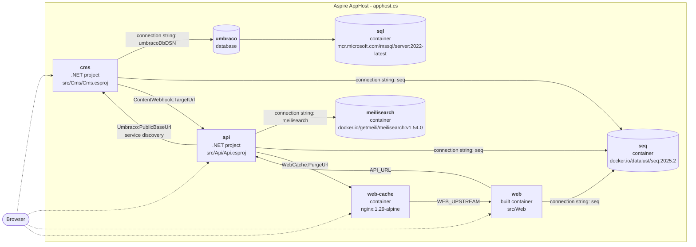

# Aspire headless CMS demo

An [Aspire](https://aspire.dev) solution with a headless **Umbraco 18** CMS, a typed **.NET 10 API** with
swappable content and search adapters, **Meilisearch** for search, and an **Astro 7 + Tailwind 4 + shadcn/ui** SSR website.
Local development runs entirely from the Aspire AppHost (`apphost.cs`); Azure deployment uses Terraform
(`infra/terraform`, see [docs/deployment.md](docs/deployment.md)).
Guidance for coding agents (commands, generated files, how a change flows through the stack) is in
[AGENTS.md](AGENTS.md).

## Architecture

<!-- architecture:start -->
<!-- Generated by scripts/gen-architecture.mjs from the Aspire manifest; do not edit by hand. -->



<!-- architecture:end -->

The diagram is generated from the AppHost model (resources and the references between them, via the Aspire
manifest): `node scripts/gen-architecture.mjs` rewrites it, and CI commits the update on `main` after any change to
`apphost.cs`. Dotted arrows are external endpoints.

- **cms** – Umbraco with the Delivery API enabled and protected by an API key (`PublicAccess=false`). There is no
  website rendering: no `AddWebsite()`/`UseWebsite()`, no Views, and templates are blocked in code
  (`src/Cms/Headless/HeadlessComposer.cs`). ImageSharp resize requests must carry a valid `hmac` (HMAC secret
  configured), so unsigned `?width=...` requests get a 400. On first start it installs unattended into SQL Server,
  imports the schema (document, element and data types) from **uSync** (`src/Cms/uSync/v18`), seeds demo content
  when `DemoContent:Enabled` is on (`ContentSeeder.cs`, `DemoArticles.cs`, `DemoBlogPosts.cs`) and registers a
  webhook pointing at the API (`ContentWebhookRegistrar.cs`). See [Content model](#content-model).
- **api** – the only thing the website talks to. It exposes a CMS- and search-engine-neutral contract
  (`src/Api/Contracts`) and builds absolute media URLs and HMAC-signed `srcset` renditions (480/960/1440/1920).
  On startup it ensures the search index and runs a full reindex in the background (retrying until the CMS has
  content). Content webhooks keep the index up to date afterwards, and a full reindex every `Search:ReindexInterval`
  (default 30 minutes, `00:00:00` disables it) catches anything a lost webhook missed. After each content webhook
  it purges the web cache.
- **web** – Astro server-side rendering only; the browser never calls the API directly. The API client is
  generated from the API's OpenAPI document.
- **web-cache** – nginx reverse proxy cache in front of the web, the site's entry point locally (see
  [Reverse proxy cache](#reverse-proxy-cache)).

## Prerequisites

- .NET SDK 10.0.300+
- Aspire CLI 13.6+ (`aspire --version`)
- Node.js 24+ and npm
- A container runtime: Docker, or **Podman** (see below)
- Optional, for deployment: Terraform 1.9+ (or OpenTofu) and the Azure CLI

## Run locally

```sh
aspire run                  # interactive; Ctrl+C to stop
# or detached:
aspire start && aspire describe
aspire stop
```

With Podman, tell Aspire which runtime to use (it is not baked into the repo because it is machine-specific):

```sh
export ASPIRE_CONTAINER_RUNTIME=podman        # bash/zsh
set -gx ASPIRE_CONTAINER_RUNTIME podman       # fish
```

What happens on start:

1. `sql`, `meilisearch` and `seq` start as **persistent** containers with data volumes (they survive `aspire stop`).
2. `cms` waits for the database, installs Umbraco unattended (first run only), imports the uSync schema
   ("uSync First boot complete" in the log; later schema changes need a backoffice import, see
   [Changing the schema](#changing-the-schema-usync-workflow)), seeds the demo content (`DemoContent:Enabled`) and
   registers the webhook. A fresh install takes about a minute; Umbraco's Delivery API query index fills about a
   minute after that.
3. `api` waits for Meilisearch, then reindexes in the background once the CMS returns content.
4. `web` runs `npm install` + `npm run dev` (Astro dev server on Aspire's `PORT`) once the api is healthy, and
   `web-cache` (nginx) starts in front of it.

### Local secrets

All secrets are Aspire parameters stored in the AppHost **user secrets** (`Parameters:<name>`), never in
`appsettings*.json` or `.env` files (`appsettings.Local.json` and `.env*` are git-ignored). `apphost.cs` sets a fixed
`UserSecretsId` (`aspire-test-apphost`), so the store is `~/.microsoft/usersecrets/aspire-test-apphost/secrets.json`
(`aspire secret path`) no matter where the repository is checked out.

Create them once before the first `aspire run` (the AppHost would also generate missing ones on start):

```sh
scripts/init-secrets.sh                        # sets only missing keys, prints the backoffice login
scripts/init-secrets.sh --rotate reindex-secret
aspire secret list                             # or: aspire secret get Parameters:umbraco-admin-password
```

| Parameter | Value |
| --- | --- |
| `umbraco-admin-email` | `admin@example.com` |
| `umbraco-admin-password`, `delivery-api-key`, `webhook-secret`, `reindex-secret`, `cache-purge-secret` | 32 random alphanumeric characters |
| `hmac-secret` | base64 of 64 random bytes |
| `sql-password`, `meilisearch-masterKey` | 32 random alphanumeric characters (Aspire's own parameters for `sql` and `meilisearch`) |

The script is idempotent and never changes an existing value: the persistent containers depend on them. It uses
`openssl rand`, `jq` and the Aspire CLI (`aspire secret`). Local Seq runs without authentication, so it has no password.

Rotating (`--rotate <name>`, then restart the AppHost):

- `delivery-api-key`, `hmac-secret`, `webhook-secret`, `reindex-secret`, `cache-purge-secret`: just restart; the cms reconciles the
  webhook's secret header on start and the api re-signs image URLs.
- `umbraco-admin-email`/`-password`: only used by the unattended install, so change the user in the backoffice too.
- `sql-password`, `meilisearch-masterKey`: fixed when the persistent container and its volume are first created.
  The script asks for confirmation and prints the `podman rm`/`podman volume rm` commands; running them deletes the
  data (see [Start from a clean database](#start-from-a-clean-database)).

Before the fixed `UserSecretsId`, the SDK derived the ID from the AppHost path (`apphost-<sha256>`). The first run of
`scripts/init-secrets.sh` copies the keys of such an existing store that the new ID lacks, so run it after pulling this
change and before `aspire run`; otherwise the AppHost generates a new `sql-password` that no longer matches the
existing `sql` volume. The script then warns and prints the command that restores the old value.

### Start from a clean database

uSync's first-boot import only runs against an empty database, and the seeder only tops up its own demo content on an
existing one. To reinstall from scratch, for example after pulling a schema change that conflicts with your local
data, stop the AppHost and remove this AppHost's `sql`/`meilisearch` containers and volumes plus local media and
Examine indexes (the hash in the names is per AppHost path; check with `podman ps -a` / `podman volume ls`):

```sh
aspire stop
podman rm -f sql-<hash> meilisearch-<hash>
podman volume rm apphost-<hash>-sql-data apphost-<hash>-meilisearch-data
rm -rf src/Cms/wwwroot/media src/Cms/umbraco/Data/TEMP
aspire start
```

## URLs

| What | URL |
| --- | --- |
| Aspire dashboard | `https://localhost:17039` (the login link with token is printed by `aspire run` / `aspire start`) |
| Seq (log search) | `http://localhost:5341` (no login locally) |
| Website | shown on the `web-cache` resource in the dashboard (random port; the reverse proxy cache, see below). The `web` resource's own URL bypasses the cache |
| Umbraco backoffice | `https://localhost:44350/umbraco` (or `http://localhost:28048/umbraco`) |
| Backoffice login | user `admin@example.com` (parameter `umbraco-admin-email`), password = `Parameters:umbraco-admin-password` from the user secrets |
| API reference (Scalar) | `http://localhost:5194/scalar` |
| OpenAPI document | `http://localhost:5194/openapi/v1.json` |
| Delivery API (needs `Api-Key` header) | `http://localhost:28048/umbraco/delivery/api/v2/content/item/articles` |

Scalar and the OpenAPI document are mapped in every environment on purpose for this demo (`src/Api/Program.cs`).

### API endpoints

| Method | Path | Notes |
| --- | --- | --- |
| GET | `/api/content?path=/articles&culture=` | `Page` or 404 ProblemDetails |
| GET | `/api/content/{id}` | `Page` or 404 |
| GET | `/api/navigation` | `NavItem[]` tree of site and pages (articles and blog posts are excluded) |
| GET | `/api/articles?tag=&page=1&pageSize=12&culture=` | `Paged<ArticleSummary>`, newest `publishDate` first |
| GET | `/api/tags` | `TagCount[]` (`{tag, count}`), most used first |
| GET | `/api/search?q=&page=1&pageSize=10&contentType=&tag=&year=` | `SearchResult`, highlights wrapped in `<mark>`; hits carry tags, date, image; `facets` counts types, tags and years (each ignoring its own filter); empty `q` lists everything newest first |
| POST | `/api/search/reindex` | full reindex; header `X-Reindex-Secret` (parameter `reindex-secret`) |
| POST | `/api/webhooks/content` | Umbraco webhook (`{"id": ...}` or `[{"id": ...}]`); header `X-Webhook-Secret` |
| GET | `/api/status` | `StatusReport` (`status` + `components[]` of `{name, displayName, status, durationMs}`), always 200; see below |

`/api/status` runs the health checks tagged `dependency`. Each adapter registers its own inside its `AddXxx` method
(Umbraco: `content`, one Delivery API query with the key, `Degraded` on failure; Meilisearch: `search`, its
`/health`, `Unhealthy` on failure), so a new adapter does the same and the endpoint stays adapter-neutral. Each
check has a 2 s timeout and the report is cached for 10 s (concurrent callers share one evaluation), so the page
never hammers the dependencies and `checkedAt` can be up to 10 s old. The status is in the body and the response is
always 200; only names, statuses and durations are returned, never exception messages, URLs or keys.

Trigger a reindex by hand:

```sh
curl -X POST -H "X-Reindex-Secret: <reindex-secret>" http://localhost:5194/api/search/reindex
```

The webhook secret is deliberately not accepted there: it is stored on the Umbraco webhook, where backoffice users
with Settings access can read it.

Website routes: `/`, `/articles` and `/blog` (block pages), `/articles/<slug>` (article), `/blog/<slug>` (blog post,
with a card linking its related article), `/tags/<tag>` (paged listing),
`/search?q=&tag=`, `/status` (system status: Web, API round trip and each `/api/status` component; `no-store`, a
Refresh link instead of auto-reload, and still renders with "API Down / Dependencies Unknown" when the API fails or
takes longer than 3 s). `/status` is a web route, so a CMS page at that path is hidden behind it.

### Reverse proxy cache

`web-cache` (nginx, `infra/web-cache/nginx.conf.template`) sits in front of `web`. The web app decides what is
cached: `src/Web/src/middleware.ts` gives every 200 GET page that sets no `Cache-Control` of its own
`public, max-age=0, s-maxage=60, stale-while-revalidate=300, stale-if-error=86400`, so nginx serves a page for up to
a minute, then refreshes it in the background, and keeps serving the last good copy for a day while the web app is
down; browsers always revalidate. `/status` sends `no-store` and `/api/suggest` `max-age=60`; error responses,
responses with `Set-Cookie` and the Vite dev assets (`no-cache`) are never cached. Concurrent misses for one URL
are collapsed into a single upstream request (`proxy_cache_lock`).

Invalidation on publish: the CMS's content webhook (publish, unpublish, delete, move to recycle bin, move) goes to
the API, which updates the search index and then calls `POST /_purge` on `web-cache` with the `X-Purge-Secret`
header (parameter `cache-purge-secret`; `src/Api/Caching/WebCachePurger.cs`). Purging after the index update keeps
list pages, which read from search, from being re-cached with stale results. nginx (open source) cannot delete
entries, so `infra/web-cache/cache.js` (njs) keeps a cache generation in shared memory that is part of the cache key:
a purge bumps it, every cached page becomes a miss, and the orphaned entries age out (`inactive`/`max_size`). A
manual reindex (`POST /api/search/reindex`) purges too; content seeded at startup reaches the same endpoint through
`SearchIndexNotifier`. A failed purge is only logged, and the minute-long `s-maxage` stays as the safety net.
Browsers are unaffected (`max-age=0`, except `/api/suggest`, which they may keep for a minute).

```sh
curl -X POST -H "X-Purge-Secret: <cache-purge-secret>" http://localhost:<web-cache port>/_purge   # 204
```

A purge empties the whole cache, so after a publish the first request for every page goes to the web app. Right
after a purge there is no stale copy to fall back on if the web app is down. A page that rendered with a degraded
section (for example "Articles are temporarily unavailable") can be served until the next purge or for up to a
minute. Check the cache with the `X-Cache-Status` response header (`MISS`, `HIT`, `STALE`, `UPDATING`, ...);
`curl -H 'Pragma: no-cache'` bypasses it. The cache lives in the container, so it is empty after every restart.
The Azure deployment (`infra/terraform`) has no cache in front of the web yet.

## Observability (local)

- **Aspire dashboard** – traces, metrics, structured logs and console output of every resource.
- **Seq** (`http://localhost:5341`) – searchable log and trace store that survives restarts (persistent container
  + data volume). `WithReference(seq)` gives cms, api and web a `ConnectionStrings__seq`; `AddServiceDefaults()`
  then ships OpenTelemetry logs and traces to Seq *in addition to* the dashboard (`AddSeqEndpoint`, Aspire.Seq).
  Seq's health check is disabled there so a stopped Seq never marks an app unhealthy. Umbraco logs through
  Serilog, which bypasses that pipeline, so `src/Cms/Program.cs` adds two Serilog OpenTelemetry sinks (dashboard
  and Seq). The Node web app preloads `src/Web/otel.mjs` (`node --import`, in
  `npm run dev`/`start` and the Dockerfile): http server and fetch (undici) spans plus log records go to the
  dashboard when `OTEL_EXPORTER_OTLP_ENDPOINT` is set (grpc or http/protobuf) and to `<seq>/ingest/otlp`
  (http/protobuf, `X-Seq-ApiKey` from `Aspire__Seq__ApiKey`) when `ConnectionStrings__seq` is set; with neither it
  does nothing. Server logs go through `src/lib/log.ts`, one record per request from `src/middleware.ts`.
  Filter by app in Seq with `@Resource.service.name = 'cms'` (or `api`, `web`); for example `@Message like '%uSync%'`
  shows the first-boot import and `@MessageTemplate like 'Reindex%'` the api's index sync.
- `/health` (all checks, status text only) and `/alive` (liveness) are mapped in every environment.
- Seq signals and alerts (error spike, webhook secret rejections, reindex/Meilisearch failures, Delivery API
  failures) are created by `infra/seq/alerts.sh`; try them locally (authentication is off, so any key works):

  ```sh
  SEQ_URL=http://localhost:5341 SEQ_API_KEY=local infra/seq/alerts.sh   # needs podman or docker, curl, jq
  ```

Seq is free for a single user; see [docs/deployment.md](docs/deployment.md#seq) for licensing and the Azure setup.

## Content model

The schema lives in **uSync** files (`src/Cms/uSync/v18`, uSync 18.2.0) and is the source of truth: on a fresh
database uSync imports it on first boot (`uSync:Settings:ImportOnFirstBoot`), before the seeder runs.

| Type | Kind | Properties | Allowed under |
| --- | --- | --- | --- |
| `site` | document | `blocks` (Content Blocks) | root |
| `page` | document | `title`, `blocks` (Content Blocks) | `site`, `page` |
| `article` | document | `title`, `image` (single image), `body` (Markdown), `tags` (group `articles`), `publishDate` (optional; falls back to the create date) | `page` |
| `heroBlock` | element | `heading`, `subheading`, `image`, `ctaLabel`, `ctaLink` (one link) | Content Blocks |
| `ctaBlock` | element | `heading`, `text`, `link` (one link), `style` (`primary`/`secondary`) | Content Blocks |
| `latestArticlesBlock` | element | `heading`, `count` (1–50, empty = 6), `tag` (optional, a single tag; a list or `!tag` is ignored); a slider on the web | Content Blocks |
| `articleListBlock` | element | `heading`, `pageSize` (1–50, empty = 12); all articles with topic/year filters and a pager, read by the web from `/api/search` | Content Blocks |
| `blogPost` | document | `title`, `image` (single image), `body` (Markdown), `relatedArticle` (Content Picker; anything but an article is ignored), `publishDate` (optional; falls back to the create date) | `page` |
| `latestBlogPostsBlock` | element | `heading`, `count` (1–50, empty = 6); the newest blog posts as a slider on the web | Content Blocks |
| `blogPostListBlock` | element | `heading`, `pageSize` (1–50, empty = 12); all blog posts with a year filter and a pager, read by the web from `/api/search` | Content Blocks |

**Demo content is opt-in.** The seeder only runs when `DemoContent:Enabled` is `true`, which `apphost.cs` and
`infra/terraform/containerapps.tf` set for this demo (`DemoContent__Enabled`). Starting a real project from this
repository: remove those two lines (or delete `ContentSeeder.cs`, `DemoArticles.cs` and `DemoBlogPosts.cs` and the
`ContentSeeder` registration in `HeadlessComposer.cs`). The CMS then boots with the schema and no content; create a
`site` node in the backoffice, because until one exists the website answers 404 on every page. Switching it off on
a seeded database leaves the existing content alone.

Seeded demo content (`ContentSeeder.cs`, idempotent, deterministic seed, one transaction so a failed seed leaves
nothing behind and is retried on the next boot): **Home** (`site`, blocks hero, latest articles ×6, latest blog
posts ×8, CTA) → **Articles** (`page`, `/articles`, blocks hero, article list) → 1500 articles with Markdown bodies,
2–4 of 12 tags each, about one publish date a day going back four years; **Blog** (`page`, `/blog`, blocks hero, blog
post list) → 500 blog posts (`DemoBlogPosts.cs`), each referring to an article on the same subject, about one every
three days; and 12 generated 1600×900 JPEG placeholder images in the media library. An install seeded with fewer
articles or blog posts is topped up on boot (by name), an Articles page still holding the old seeded latest-articles
block is switched to the article list (once `articleListBlock` has been imported, see below), and a Home page still
in the layout seeded before blog posts existed gets the blog slider and a Blog page (once the blog types have been
imported; deleting the Blog page afterwards is respected). Whatever the seeder creates is posted straight to the API's content
webhook endpoint (`SearchIndexNotifier.cs`), because Umbraco's own webhook queue does not reliably fire for content
published during startup. Content is created in C#, not via uSync content import, so the repo
only holds schema and no media files.

`src/Cms/Headless/ArticleQueryHandlers.cs` adds two Delivery API query extensions the API relies on:
`sort=publishDate:asc|desc` and `filter=tag:<a,b>` (any of the tags, `!` to exclude, case-insensitive).

How the API exposes it (`src/Api/Contracts`):

- `Page.blocks` is a polymorphic `Block[]` with discriminator `type` (`hero` | `cta` | `latestArticles` |
  `articleList` | `latestBlogPosts` | `blogPostList`; OpenAPI `oneOf` + discriminator, a TypeScript discriminated
  union in the web). `latestArticles` and `latestBlogPosts` blocks arrive resolved (`articles: ArticleSummary[]`,
  `posts: BlogPostSummary[]`). Links are `{url, title?, target?}`; content links become site paths
  (`/articles`).
- `Page.article` is non-null exactly when `contentType == "article"`: `{publishDate, tags, bodyHtml,
  readingTimeMinutes}`. The Markdown is rendered by Markdig with raw HTML disabled and only http(s)/mailto/tel/
  relative URLs allowed, so `bodyHtml` can be inserted as-is. `Page.summary` is a ~160-character plain-text excerpt.
- `Page.blogPost` is non-null exactly when `contentType == "blogPost"`: `{publishDate, bodyHtml, readingTimeMinutes,
  relatedArticle}` (an `ArticleSummary`, or `null` when unset or not an article). Item requests ask the Delivery API
  for `expand=properties[relatedArticle]`, so the related article arrives with its title, image and body.
- Blog posts are indexed like articles (`contentType: blogPost`, with `publishYear`), so `/api/search?contentType=blogPost`
  lists them newest first.

### Changing the schema (uSync workflow)

1. Edit document types, element types or data types in the backoffice (Settings). uSync exports every saved
   change to `src/Cms/uSync/v18` (`ExportOnSave: "Settings"`; content and media are never exported, and the
   webhook handler is disabled so its secret never lands in the repo).
2. Refresh the Delivery API document and models (`node scripts/gen-delivery-api.mjs --from <cms url>`, see
   [Umbraco Delivery API models](#umbraco-delivery-api-models)), then review and commit the changed `.config`
   files together with `delivery-api.json`, the regenerated models and the API/web code that uses them (update
   `DeliveryApiMapper` and the fixtures in `tests/Api.Tests/Fixtures/delivery` if the JSON shape changes).
3. Other machines and new environments get the schema on a fresh database automatically. For an existing
   database, import it in the backoffice: Settings > uSync > Import (or reset the local database, see
   [Start from a clean database](#start-from-a-clean-database)).

## Adapters: how the API stays CMS/search-engine neutral

The endpoints only depend on two ports and the contract records:

- `src/Api/Content/IContentSource.cs` – `GetByPathAsync`, `GetByIdAsync`, `GetNavigationAsync`,
  `GetArticlesAsync`, `GetTagsAsync`, plus the enumeration used for indexing.
- `src/Api/Search/ISearchIndex.cs` – `SearchAsync`, `ReplaceAllAsync`, `CountAsync`, upsert/delete and path lookups.

Implementations live in adapter folders and never leak their types into `Contracts/` or `Endpoints/`:

- `src/Api/Content/Umbraco/` – typed `HttpClient` against the Umbraco Delivery API v2 (`DeliveryApiMapper` maps the
  [generated Delivery API models](#umbraco-delivery-api-models) to `Page`, `ImageUrlSigner` signs renditions with
  ImageSharp.Web's `HMACUtilities`).
- `src/Api/Search/Meilisearch/` – Meilisearch client (`AddMeilisearchClient("meilisearch")`), index `content`.

The adapter is chosen at startup from configuration (`Providers:Content`, `Providers:Search`); an unknown value
throws at startup. The AppHost sets `Providers__Content=Umbraco` and `Providers__Search=Meilisearch`.

### Umbraco Delivery API models

The CMS's Delivery API OpenAPI document is the source of truth for the content the Umbraco adapter reads. With
`Umbraco:CMS:DeliveryApi:OpenApi:GenerateContentTypeSchemas` on (`src/Cms/appsettings.json`), Umbraco describes every
document, element and media type in it, with `contentType` / `mediaType` as discriminators. The document is committed
as `src/Api/Content/Umbraco/delivery-api.json`, and `DeliveryApiModels.g.cs` (records in
`Api.Content.Umbraco.Delivery`) is generated from it, so a property the mapper reads that the content model does not
have is a compile error, not a silent `null`.

After changing the content model (uSync, see [Changing the schema](#changing-the-schema-usync-workflow)), with the
CMS running:

```sh
node scripts/gen-delivery-api.mjs --from http://localhost:12276   # refresh delivery-api.json, regenerate the models
dotnet build src/Api                                              # then fix the mapper where the compiler says so
```

Without `--from` the script only regenerates the models from the committed document; CI fails when they differ.
Content the API meets before the document is refreshed still deserializes: an unknown content, element or media type
becomes an `Unknown*` model (its properties passed through raw on `Page.Properties`, unknown blocks skipped), and
properties the document does not list land in the `Additional` dictionary of each `*PropertiesModel`.

### Adding a provider

Example: a Contentful content source.

1. Create `src/Api/Content/Contentful/` with a `ContentfulContentSource : IContentSource`, its options and an
   `AddContentfulContentSource(this IHostApplicationBuilder)` extension that registers it (typed `HttpClient`,
   options validation, ...). Map the provider's JSON to the contract records there.
2. Add one switch arm in `src/Api/Content/ContentServiceCollectionExtensions.cs`:

   ```csharp
   case "Contentful":
       builder.AddContentfulContentSource();
       break;
   ```
3. Set `Providers__Content=Contentful` (AppHost `WithEnvironment`, or Terraform for Azure) plus the provider's own
   settings. Feed index updates by calling `POST /api/webhooks/content` with `{"id": "..."}` from the new CMS, or
   rely on `POST /api/search/reindex`.

A new search engine works the same way: `src/Api/Search/<Engine>/` implementing `ISearchIndex`, plus one arm in
`src/Api/Search/SearchServiceCollectionExtensions.cs` and `Providers__Search=<Engine>`.

## Regenerating the web API types

`dotnet build src/Api` regenerates `src/Api/openapi/Api.json` (Microsoft.Extensions.ApiDescription.Server). The
website's types are generated from that file and committed:

```sh
dotnet build src/Api
cd src/Web
npm run gen:api      # openapi-typescript ../Api/openapi/Api.json -> src/lib/api/schema.d.ts
npm run build        # astro check + astro build
```

### UI components (shadcn/ui)

The website's UI baseline is [shadcn/ui](https://ui.shadcn.com) (style `radix-nova`, `components.json`): primitives
live in `src/Web/src/components/ui` (add more with `npx shadcn@latest add <name>` in `src/Web`) and the theme tokens
(`background`, `foreground`, `primary`, `muted`, `border`, `ring`, …) in `src/styles/global.css`, where `primary` is the
site's indigo. Use the tokens rather than raw palette colours. shadcn components are React (`@astrojs/react`) and are
rendered on the server only: pages ship no React unless a component is given a `client:*` directive. Compose them in
`.tsx` components (`ArticleCard`, `Pager`, `FacetFilters`, …) rather than passing Astro children into them (Astro wraps
slot content, which breaks `asChild` and child selectors); in `.astro` files style links with `buttonVariants()` /
`badgeVariants()`.

## Tests

```sh
dotnet build AspireTest.slnx
dotnet test AspireTest.slnx     # HMAC signing vs real ImageSharp.Web middleware, Delivery API mapping (fixtures
                                # captured from the running CMS), Markdown safety, polymorphic JSON, provider selection,
                                # /api/status (caching, no leaked error details, adapter health checks)
```

## CI

`.github/workflows/ci.yml` runs on pull requests and pushes to `main`, as five parallel jobs:

| Job | Steps |
| --- | --- |
| `dotnet` | restore, `dotnet build AspireTest.slnx -c Release`, `dotnet build apphost.cs`, `dotnet test AspireTest.slnx` (TRX uploaded), fails if the build changed `src/Api/openapi/Api.json` or `DeliveryApiModels.g.cs` is out of date with `delivery-api.json` |
| `architecture` | regenerates the README architecture diagram from the AppHost (`node scripts/gen-architecture.mjs`); warns on drift in pull requests, commits the update on `main` |
| `web` | Node from `src/Web/.nvmrc`, `npm ci`, `npm run gen:api` and fail on `schema.d.ts` drift, `astro check`, `astro build` |
| `terraform` | `terraform fmt -check`, `terraform init -backend=false -lockfile=readonly`, `terraform validate` |
| `images` | builds the `cms`, `api` and `web` images (no push) with the same context/Dockerfile as [docs/deployment.md](docs/deployment.md) |

Keep these green locally:

- After changing an endpoint or contract: `dotnet build src/Api`, then `npm run gen:api` in `src/Web`, and commit
  both `Api.json` and `schema.d.ts`.
- After changing Terraform providers, update the lock file for every platform the team and CI use:
  `terraform providers lock -platform=linux_amd64 -platform=darwin_arm64 -platform=windows_amd64`.
- The Node major is set in `src/Web/.nvmrc`; keep it in line with the `src/Web/Dockerfile` base image.
- The AppHost build (`AspireUseCliBundle=true`) needs no Aspire CLI on the runner: without one it fetches the
  matching CLI bundle with `dotnet dnx`.

## Deployment

Azure (Container Apps, Azure SQL, Blob Storage for media, Azure Files for Meilisearch, Key Vault, ACR) is described
in Terraform under `infra/terraform`. See **[docs/deployment.md](docs/deployment.md)** for the architecture, building
and pushing images, `terraform apply`, the first run and secret rotation.
